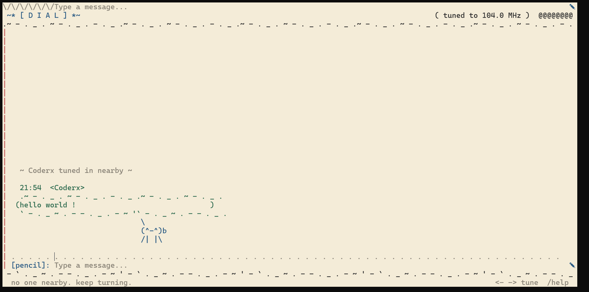

# *Dial* 

*A little radio chat you ssh into. and  then you can talk to anyone worldwide via your terminal yeh(but , they also need to be on the radio tho)*

## *Why does this exist:*

(*Because somebody said "what if there can be a radio where strangers can talk" and nobody stopped them.*)

(*And also cuz the [Crescent's multiplayer card](https://crescent.hackclub.com/guides/multiplayer) gave me a new reason for creating my this long envisioned project.*)

## *How it works:*

*Your terminal connects over ssh, and boom you are in a terminal where you can talk to anybody worldwide just radio and you*

*As you change through frequency there are few things to mind:*
- Someone can only read message from peoples on same frequency they are.
- If you are close enough to some frequency where peoples are talking, you can see thier messages but jumbled(with distortion).
- The message doodle of a person turns green in message indicating that you are on same frequency as that person is. 

## *Try it(yay!!):*

```
ssh -p 3453 2a01:4f9:3080:3192::1994
```

(*this is a public server, but you can always host your own copy of it, yeh really its here in this repo itself.*)


## *Screenshot:*



(*this is for your welcome!!*)


(*yeh this is how it looks*)


## *Run your own server:*

*clone the repo (yeh i know you know how to do this) and i hope node is downloaded on you machine(yeh really hope so).*

*then run this both commands one by one in your local copy of repo*

```
npm install
```
```
npm start
```

-> *be happy now you have the server running on your localhost  port 2222(default) (use arg { DIAL_HOST="::" PORT=3453 } for exposing it on public ip and another port if needed.)*

*For testing after running local server use following command to connect to it:*

```
ssh -p 2222 localhost
```

## *Commands*

| command | what it does |
|---|---|
| `←` `→` | turn the dial. find people. |
| `/freq 98.5` | teleport to a frequency |
| `/who` | who's on air near you |
| `/theme chalk` | parchment, pad, chalk, blueprint |
| `/doodle 3` | change your little face |
| `/name sam` | change what people call you |
| `/help` | all the commands you need to know about in-chat. |
| `/quit` | go off air |


(*AI usage note: AI is only used in debugging when i lose my mind due to a bug , except for this and some nest server lag problem fix AI is not used anywhere else.*)

(*there are some easter eggs in the chat , hunt for them*)


-----------------------------------------------------------------------------------------------------------------------------------------

Made by a teen for [hackclub ysws](https://crescent.hackclub.com/).