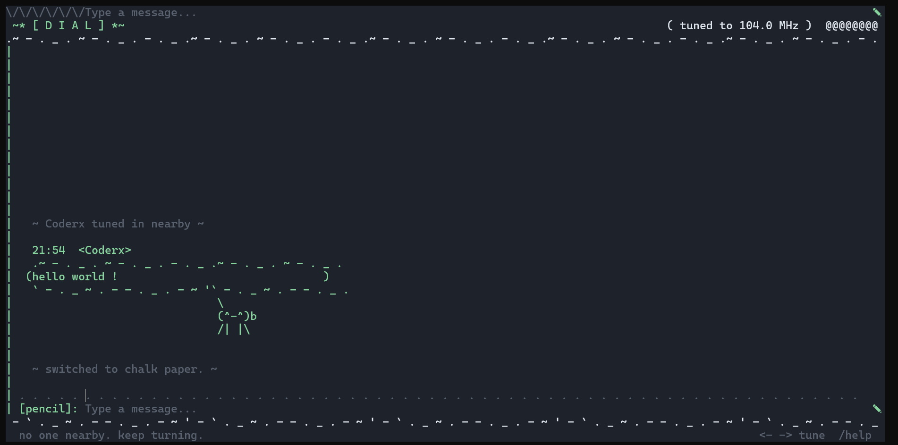

# *Dial* 

*A little radio chat you ssh into.*

## *Why does this exist:*

(*Because somebody said "what if there can be a radio where strangers can talk" and nobody stopped them.*)

## *How it works:*

*Your terminal connects over ssh, and boom you are in a terminal where you can talk to anybody worldwide just radio and you*

## *Try it(yay!!):*


```
ssh -p 3453 2a01:4f9:3080:3192::1994
```

(*this is a public server, but you can always host your own copy of it, yeh really its here in this repo itself.*)


## *Screenshot:*



(*yeh this is how it looks*)


## *Run your own server:*

*clone the repo (yeh i know you know how to do this) and i hope node is downloaded on you machine(yeh really hope so).*

*then run this both commands one by one in your local copy of repo*

```
npm install
```
```
npm start
```

-> *be happy now you have the server running on your localhost  port 2222(default) (use arg { DIAL_HOST="::" PORT=3453 } for exposing it on public ip and another port if needed.)*

*For testing after running local server use following command to connect to it:*

```
ssh -p 2222 localhost
```

## *Commands*

| command | what it does |
|---|---|
| `←` `→` | turn the dial. find people. |
| `/freq 98.5` | teleport to a frequency |
| `/who` | who's on air near you |
| `/theme chalk` | parchment, pad, chalk, blueprint |
| `/doodle 3` | change your little face |
| `/name sam` | change what people call you |
| `/help` | the list you're reading but in-game |
| `/quit` | go off air |


-----------------------------------------------------------------------------------------------------------------------------------------

made by a teen for [hackclub ysws](https://crescent.hackclub.com/)
